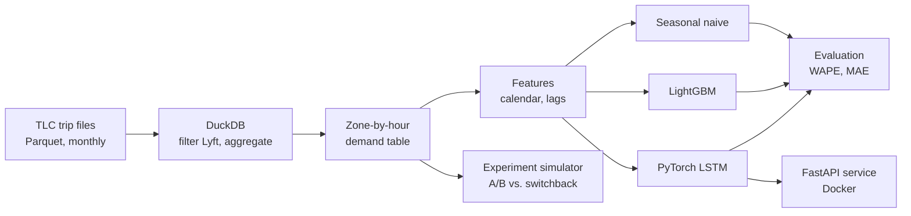

# Ride-demand forecasting and marketplace experiment simulator

**Status: in progress.** The roadmap below shows what is done.

Forecasts hourly ride demand for each NYC taxi zone using Lyft trips from the public
[NYC TLC High-Volume For-Hire Vehicle trip records](https://www.nyc.gov/site/tlc/about/tlc-trip-record-data.page),
then uses those forecasts to simulate pricing experiments in a two-sided marketplace.

## Roadmap

- [ ] **Data pipeline:** download monthly trip files, aggregate Lyft trips to a zone-by-hour table with DuckDB
- [ ] **Exploration:** daily and weekly seasonality, differences between zones, anomalies
- [ ] **Models:** seasonal-naive baseline, LightGBM, PyTorch LSTM, compared on WAPE and MAE
- [ ] **Serving:** FastAPI prediction service in Docker
- [ ] **Experiment simulator:** power analysis, rider-level A/B test vs. switchback test under marketplace interference
- [ ] **Deployment:** model files in S3, service on AWS ECS Fargate, and on a local Kubernetes cluster (kind)

## How it fits together



More diagrams are in [docs/architecture.md](docs/architecture.md).

## Setup

Requires [uv](https://docs.astral.sh/uv/). uv installs Python 3.12 for this project by itself.

```bash
uv sync                  # create .venv and install dependencies
uv run pytest            # run the tests
uv run python -m ridecast.data.download 2026-06 2026-07 2026-08
```

On macOS, LightGBM needs OpenMP: `brew install libomp`.

## Layout

```
src/ridecast/
  config.py            paths and constants
  data/download.py     fetch monthly Parquet files
  data/aggregate.py    raw trips -> zone-by-hour table (DuckDB)
  features.py          calendar and lag features
  splits.py            time-based train/validation/test split
  metrics.py           WAPE, MAE
  models/              seasonal naive, LightGBM, LSTM
notebooks/             exploration only
tests/                 pytest
docs/                  architecture notes and diagrams
```
