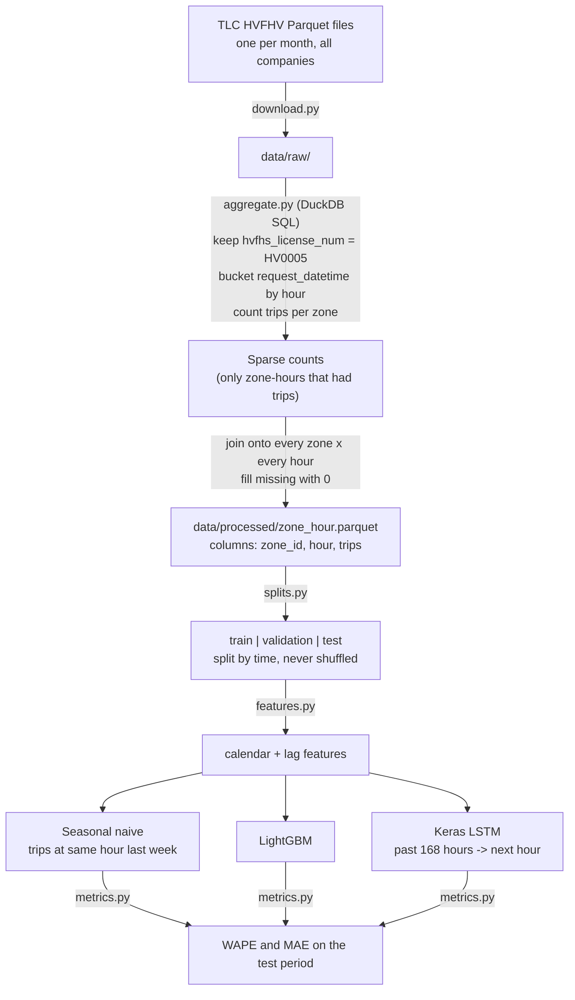
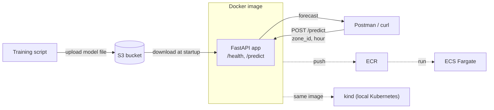
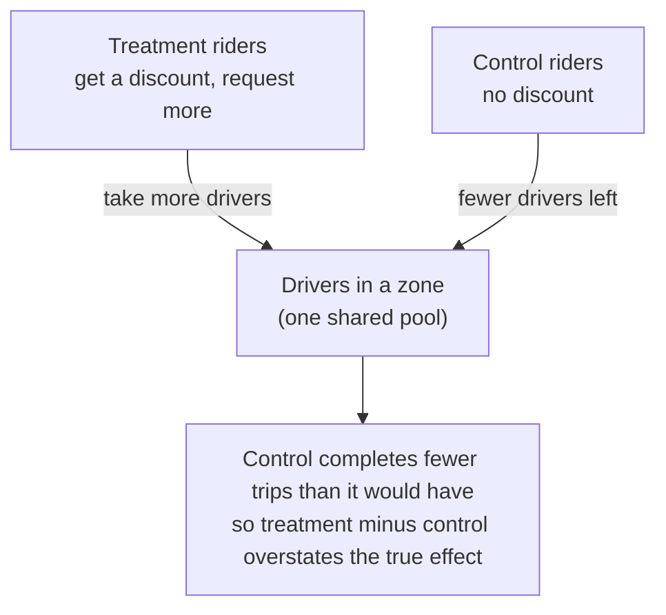

# Architecture

GitHub renders these diagrams. In VS Code, install the "Markdown Preview Mermaid Support" extension.

## 1. Training pipeline (Phase 1)

Why the zero-fill step matters: a zone with no trips at 4 a.m. has no row in the raw
data. Without the fill, the model never sees a zero, lag features point at the wrong
hour, and the error metrics skip the quiet hours.

## 2. Serving and deployment (Phases 2 and 3)

The model file lives in S3, not inside the image, so a retrained model ships without
rebuilding the container.

## 3. Why a rider-level A/B test is biased in a marketplace (Phase 2)

A switchback test randomizes whole zone-and-time blocks instead of riders, so both
groups never compete for the same drivers at the same time. The cost is fewer
independent units, so the estimate is noisier.
